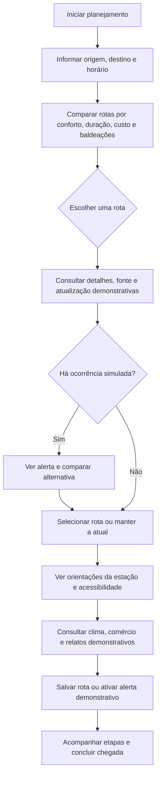

# PRD — ConfyCity App

**Responsáveis:** Caio Sampaio, Isaque Falcão e Otávio Luiz  
**Data:** 07/11/2026  
**Status:** Rascunho para validação  
**Versão:** Protótipo navegável 0.1

## 1. Visão geral

O ConfyCity App é uma proposta de aplicativo de mobilidade que ajuda passageiros de transporte público a comparar rotas considerando conforto, duração, custo e condições do trajeto. Este PRD especifica um protótipo navegável para demonstrar a jornada completa e investigar se as informações ajudam a escolher uma rota equilibrando esses fatores.

O protótipo usa dados simulados e identificados como demonstrativos. Não é um serviço operacional e não consulta localização, operadores ou dados de transporte em tempo real.

## 2. Contexto e evidências

Os materiais do projeto apontam lotação, desconforto físico, imprevisibilidade e informações dispersas como dores relevantes para investigar:

- Na entrevista, Yara relata não conseguir embarcar em um trem lotado e esperar pelo próximo, também cheio.
- Camila relata que aceitaria uma rota 20 minutos mais longa se pudesse viajar sentada e com ar-condicionado. Também descreve consultar diferentes aplicativos e redes sociais para entender a situação do transporte.
- Victor expressa preferência por uma alternativa mais longa e confortável em um cenário hipotético, além de dizer que aguardaria em local anterior à plataforma se soubesse que ela estava lotada.
- A Matriz CSD identifica como dúvidas a disponibilidade, cobertura, atualização e precisão dos dados de lotação, e o quanto diferentes passageiros trocariam tempo por conforto.

São evidências qualitativas de entrevistas, não resultados representativos de todos os passageiros. Não há validação de dados operacionais disponíveis nem evidência de que as estimativas propostas possam ser produzidas com precisão suficiente.

**Fontes do projeto:** [Matriz CSD](./Atividade%201%20-%20Matriz%20CSD.md), [Entrevista 1 — Yara](./Atividade%203%20-%20Entrevista%201%20Yara.md), [Entrevista 2 — Camila](./Atividade%203%20-%20Entrevista%202%20Camila.md), [Entrevista 3 — Victor](./Atividade%203%20-%20Entrevista%203%20Victor.md), [One-Pager](./Atividade%205%20-%20ConfyCity%20App%20OnePager.md) e [Metas de Usabilidade](./Atividade%205%20-%20Metas%20de%20Usabilidade%20ConfyCity.md).

## 3. Público e personas

**Público-alvo inicial:** pessoas que usam transporte público e desejam ponderar conforto e previsibilidade, além de duração e custo, ao planejar um trajeto.

**Perfil de referência para os testes:** passageiro com deslocamentos que podem incluir lotação, baldeações e compromissos com horário; precisa comparar alternativas e decidir se prefere seguir, esperar ou mudar de rota. Esse perfil é uma síntese de necessidades observadas nas entrevistas, não uma persona demográfica validada.

**Ator do protótipo:** passageiro. Não há perfis administrativos ou de operador.

## 4. Proposta de valor

Dar ao passageiro uma visão comparável das alternativas de transporte e de seus trade-offs de conforto, tempo, custo e condições reportadas, para que escolha como prosseguir com mais informação. A utilidade, a confiança e a cobertura dos dados reais continuam sendo hipóteses.

## 5. Objetivos e métricas

**Objetivo de validação principal:** verificar se passageiros compreendem as informações apresentadas e conseguem escolher uma rota considerando conforto, tempo e custo.

Em testes moderados com participantes, observar:

- conclusão da tarefa de informar origem e destino e encontrar alternativas;
- capacidade de explicar diferenças de duração, custo, lotação estimada e baldeações;
- rota escolhida e justificativa apresentada pelo participante;
- entendimento de que os dados são simulados e de sua origem/horário demonstrativos;
- erros, pedidos de ajuda e pontos de hesitação durante a decisão.

Não há metas numéricas definidas. Estabelecer critérios quantitativos após uma rodada inicial de observação.

## 6. Escopo

### Incluído no protótipo

Uma jornada navegável do planejamento até a chegada, com:

1. busca de origem, destino e horário;
2. comparação de rotas por duração, custo, baldeações e conforto/lotação estimada;
3. detalhes da rota e explicação da origem e atualização simuladas dos dados;
4. situação do transporte e ocorrência demonstrativa, com sugestão de alternativa;
5. configuração e visualização de alertas agendados dentro do protótipo;
6. navegação ilustrativa em estação e informações de acessibilidade;
7. informações demonstrativas de clima e comércios de interesse;
8. registro colaborativo simulado, com fonte e horário claramente identificados como demonstração;
9. salvamento e consulta de rotas salvas em uma experiência offline simulada.

### Fora do escopo

- Dados ao vivo, integração com operadores, mapas ou serviços externos.
- Geolocalização real, notificações push, cadastro, autenticação ou backend.
- Publicação ou transmissão real de relatos de usuários.
- Garantia de acessibilidade física, segurança operacional, assento disponível ou condição real de um veículo.
- Recarga de bilhetes, pagamento, reservas ou compra de produtos.

### Prioridade

A comparação de rotas e a compreensão de seus trade-offs formam o fluxo principal de validação. Os demais recursos devem ser acessíveis no protótipo e demonstrados como extensões da mesma jornada, sem sugerir que são serviços reais.

## 7. Jornada e fluxo

### Exceções demonstradas

- Origem ou destino ausente: solicitar o campo faltante sem iniciar a busca.
- Nenhum resultado demonstrativo: explicar que não há rota no conjunto simulado e permitir editar a busca.
- Dados indisponíveis ou desatualizados: apresentar estado explícito; não mostrar o dado como atual.
- Ocorrência em rota: permitir comparar alternativa e manter a rota escolhida.
- Sem conexão: oferecer rotas previamente salvas no protótipo e identificar que outras informações podem não estar disponíveis.

## 8. Telas e navegação

1. **Início / planejamento:** campos de origem, destino e horário; acesso a rotas salvas; aviso persistente de ambiente demonstrativo.
2. **Resultados:** cartões comparáveis com duração, custo simulado, baldeações, nível de lotação estimado e indicação textual de conforto. Oferecer ordenação simples e ação para abrir detalhes.
3. **Detalhes da rota:** etapas e conexões, critérios da estimativa, fonte e horário simulados, acessibilidade e ação para selecionar/salvar.
4. **Ocorrência e alternativas:** aviso demonstrativo, impacto na rota e comparação lado a lado com outras opções; permitir trocar ou manter a rota.
5. **Etapa da viagem / estação:** lista de etapas, orientação esquemática de navegação, acessibilidade reportada e ações para consultar informações complementares.
6. **Alertas e relatos:** criar/visualizar um alerta agendado demonstrativo e registrar um relato local apenas para demonstrar a interação; identificar ambos como simulados.
7. **Rotas salvas:** listar trajetos salvos e permitir abri-los em modo de consulta offline demonstrativo.
8. **Chegada:** confirmar visualmente o encerramento da jornada e permitir voltar ao início.

Em todas as telas, manter navegação simples, linguagem direta, indicação clara da etapa atual e acesso ao planejamento. Não depender apenas de cor para comunicar lotação, acessibilidade ou alertas.

## 9. Requisitos funcionais

| ID | Requisito | Prioridade |
|---|---|---|
| RF-01 | Permitir informar origem, destino e horário com validação de campos obrigatórios. | P0 |
| RF-02 | Exibir pelo menos duas rotas demonstrativas comparáveis por duração, custo, baldeações e estimativa de conforto/lotação. | P0 |
| RF-03 | Explicar que valores, estimativas, horários, fontes e atualizações são simulados. | P0 |
| RF-04 | Permitir abrir os detalhes, selecionar uma rota e revisar a escolha. | P0 |
| RF-05 | Demonstrar uma ocorrência, seu possível impacto e pelo menos uma rota alternativa; permitir manter ou trocar de rota. | P0 |
| RF-06 | Demonstrar orientações esquemáticas de estação e informações de acessibilidade sem afirmá-las como confirmação operacional. | P1 |
| RF-07 | Exibir informações simuladas de clima e comércio associadas ao trajeto ou destino. | P1 |
| RF-08 | Permitir configurar alertas demonstrativos e mostrar confirmação dentro da interface, sem push real. | P1 |
| RF-09 | Permitir salvar e reabrir uma rota no estado offline demonstrativo. | P1 |
| RF-10 | Permitir registrar um relato demonstrativo com categoria e horário fictício/local de demonstração, sem transmiti-lo a terceiros. | P1 |
| RF-11 | Apresentar estados vazios, erros de formulário e indisponibilidade/desatualização de dados simulados. | P0 |

## 10. Histórias de usuário

- Como passageiro, quero informar meu trajeto e comparar alternativas para escolher entre conforto, duração e custo.
- Como passageiro, quero entender a origem e a atualidade de cada informação para avaliar o que é apenas demonstrativo.
- Como passageiro, quero ver uma ocorrência e uma alternativa para decidir se mantenho ou altero a rota.
- Como passageiro, quero consultar etapas, acessibilidade e informações complementares para me orientar durante a viagem.
- Como passageiro, quero salvar uma rota e consultar alertas demonstrativos para retomar o planejamento no protótipo.

## 11. Critérios de aceite

1. **Busca válida:** Dado que a pessoa está na tela inicial, quando informa origem, destino e horário e solicita rotas, então o protótipo apresenta resultados demonstrativos com os principais atributos comparáveis.
2. **Busca incompleta:** Dado que falta origem ou destino, quando a pessoa solicita rotas, então o protótipo identifica o campo pendente e não apresenta resultados como se a busca fosse válida.
3. **Comparação:** Dado que há rotas demonstrativas, quando a pessoa as compara, então consegue identificar duração, custo, baldeações e estimativa de conforto sem depender apenas de cor.
4. **Transparência:** Dado que qualquer informação simulada é exibida, então a tela informa claramente que não corresponde a dados operacionais em tempo real.
5. **Ocorrência:** Dado que a rota selecionada tem uma ocorrência demonstrativa, quando a pessoa abre o alerta, então pode comparar uma alternativa e escolher trocar ou manter a rota.
6. **Acessibilidade e estação:** Dado que a pessoa abre os detalhes de uma etapa, então encontra orientação esquemática e informação de acessibilidade com ressalva de que são demonstrativas.
7. **Alerta:** Dado que a pessoa configura um alerta, quando confirma, então o protótipo mostra a configuração e deixa explícito que não enviará notificação real.
8. **Rota salva/offline:** Dado que a pessoa salva uma rota, quando abre a lista de rotas salvas, então pode reabrir a informação demonstrativa sem conexão com serviço externo.
9. **Relato:** Dado que a pessoa registra um relato, quando confirma, então o protótipo apenas demonstra a ação localmente e informa que o relato não foi enviado.
10. **Chegada:** Dado que a pessoa percorreu as etapas do fluxo demonstrativo, quando conclui a rota, então vê um estado de chegada e consegue iniciar outro planejamento.

## 12. Regras de negócio

- Todas as rotas, custos, horários, níveis de lotação, ocorrências, fontes, comércios, dados climáticos e relatos são fixtures demonstrativas.
- Identificar o ambiente como **“Protótipo — dados simulados, não representam a operação real”** em local visível durante todo o fluxo.
- Não ordenar ou recomendar uma rota como objetivamente “mais segura” ou garantir lugar sentado. Descrever somente os atributos ilustrativos disponíveis.
- Comparações devem mostrar os mesmos campos para cada opção; se um valor estiver indisponível, identificá-lo como indisponível em vez de inferi-lo.
- Uma troca de rota atualiza a jornada demonstrativa e não representa instrução operacional.
- Alertas, contribuições e modo offline não enviam dados, não chamam APIs e não geram notificações de sistema.
- Dados persistidos para demonstração devem ficar apenas no navegador/dispositivo, sem dados pessoais desnecessários.

## 13. Dados e integrações

**Dados simulados para a interface:** origem/destino, horário, itinerários e etapas, duração, custo ilustrativo, baldeações, estimativa de lotação/conforto, acessibilidade, ocorrência, hora/fonte demonstrativa, alerta, clima, comércio e rotas salvas.

**Persistência:** estado local do protótipo; opcionalmente armazenamento local do navegador apenas para preferências e rotas demonstrativas. Não armazenar localização precisa, identidade ou dados sensíveis.

**Integrações:** nenhuma. Não criar endpoints, autenticação, banco de dados ou dependências de provedores de mapa/transporte sem autorização e definição posterior.

## 14. Requisitos não funcionais

- **Acessibilidade:** interface responsiva, estrutura semântica, operação por teclado quando possível, foco visível, contraste adequado, textos legíveis e informação não dependente apenas de cor. Instruções em áudio podem ser demonstradas por controles visuais, sem prometer navegação por voz funcional.
- **Responsividade:** priorizar experiência mobile, mantendo uso coerente em telas maiores.
- **Privacidade:** não solicitar permissão de localização nem coletar dados pessoais; manter interações de demonstração localmente.
- **Transparência:** distinguir conteúdo simulado, dado indisponível e ação apenas demonstrativa.
- **Usabilidade:** orientar-se pelas cinco metas descritas em [Metas de Usabilidade ConfyCity](./Atividade%205%20-%20Metas%20de%20Usabilidade%20ConfyCity.md), com validação posterior junto a usuários.

## 15. Riscos, decisões e pendências

### Decisões confirmadas

- Entrega é um protótipo navegável, não um MVP operacional.
- A jornada demonstrada é completa, do planejamento à chegada, com os grupos de funcionalidades definidos no One-Pager.
- A validação principal é a escolha de rota equilibrando conforto, tempo e custo.
- Usar dados simulados claramente identificados e sem integrações ou localização real.

### Riscos e hipóteses

- A apresentação de estimativas pode ser confundida com previsão real se os avisos não forem persistentes e claros.
- Muitos recursos podem distrair do objetivo de testar a comparação de rotas; o fluxo principal deve permanecer prioritário.
- Não se sabe se os dados necessários para lotação, acessibilidade e ocorrências existem com cobertura e atualização adequadas.
- Relatos colaborativos em produção exigiriam políticas de privacidade, moderação, validade temporal e prevenção de abuso, ainda não definidas.

### Pendências para uma versão operacional

- Validar necessidades e compreensão com passageiros diversos, inclusive pessoas com necessidades de acessibilidade.
- Definir cidade/linhas, cobertura multimodal, fontes autorizadas, precisão, frequência de atualização e critérios de confiança.
- Definir política de privacidade, moderação de relatos, notificações e funcionamento offline real.
- Estabelecer métricas quantitativas e critérios de sucesso após testes iniciais.
